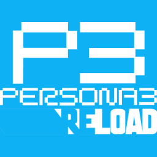

  NOTATE-PERSONA-3-RELOAD Logo" width="200"/>

<h1 align="center">NOTATE-PERSONA-3-RELOAD-PORTOFOLIO</h1>

  <strong>This Is My PortoFolio</strong>

  <a href="#-features">Features</a> •
  <a href="#-quick-start">Quick Start</a> •
  <a href="#-documentation">Docs</a> •
  <a href="#-api-examples">API</a> •
  <a href="#-contributing">Contributing</a>

  
  
  
  
  
  
  
  

---

## ✨ What About My PortoFolio in This Repositories?

Built on a **pluggable architecture**, lets you select database engines (SQLite/PostgreSQL), media storage backends (Local/S3), and an optional Redis (queue, rate limits, WebSocket fan-out) through configuration rather than application-code changes. The storage backend is the live store for status media and, when chat-media archiving is enabled, archived chat media; other message media is returned inline to API and webhook consumers. Of the media, `scripts/backup.sh` archives only the local media directory, so an S3 bucket needs a backup of its own.

Made with ❤️ by <a href="(https://github.com/Notatekuru)">Notatekurusama</a>

